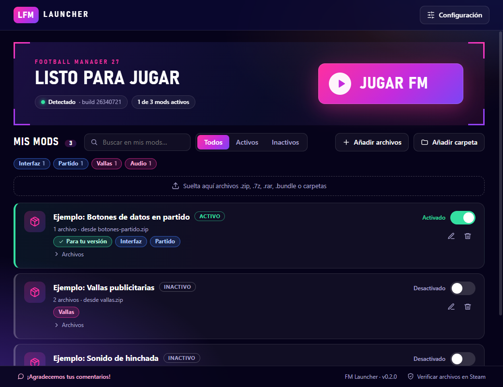

# FM Launcher

**Enable, disable and organize Football Manager 27 mods without touching files by hand.**
Drag the `.zip` just as you downloaded it, flip the switch and play.

[Versión en español](README.md)



> Fan-made project, **unofficial**. Not affiliated with or endorsed by Sports Interactive or SEGA.
> Football Manager is a trademark of its respective owners.

---

## Download

[](https://github.com/pablotapiav/fm_launcher/releases/latest/download/FM-Launcher-Setup.exe)

It installs with one click and creates a shortcut. You need **Windows 10 or 11 (64-bit)** and **FM27 on Steam**.

Prefer the **portable** version (no installation) or older versions? → **[All releases](../../releases)**

> **Windows may show a blue warning** ("Windows protected your PC"). That's normal for small programs
> without a paid code-signing certificate. Click **More info → Run anyway**.
> The code is open source: you can review it right here.

## How to use it

1. **Open the launcher.** It finds FM27 by itself. If it can't, pick the folder in *Settings*.
2. **Add a mod.** Drag the `.zip`, `.7z` or `.rar` into the window (or use *Add files* / *Add folder*).
   Folders and loose `.bundle` files work too.
3. **Flip the switch** on the mod. The launcher keeps a copy of the original file and puts the mod's in place.
4. **Press "Play FM"**. It starts the game through Steam.
5. **To go back**, flip the switch off: the original file is restored.

While the game is running you can't enable or disable mods; the launcher tells you.

## What it does for you

- **Recognizes the mod by itself**, even inside a zip that mirrors the game's structure (`fm_Data/…`).
  It never runs anything from the zip: scripts, installers and executables are ignored.
- **Automatic backups** of the original files (you can move or turn them off in *Settings*).
- **Clear conflicts, no false alarms.** It only warns when two mods replace the **same content file**
  (for example, two adboard packs that overwrite the same bundle): they can't be active at once, and the
  launcher offers **Switch to this mod** in one step. Mods for different competitions or parts of the game
  coexist with no warnings. The game catalog files (`catalog_info.*`), which almost every mod with new content
  ships, are shared: the last one enabled wins and the original is restored when the last one is disabled.
- **Smart tags** based on what each mod changes (Adboards, Audio, Interface, Stadium…) with filters.
- **Version compatibility**: if the mod's notes say which game version it is for, only the base version
  (`27.0.0`) is compared; a different build number doesn't count as a difference.
- **Detects changes**: if Steam updates or restores a file, the mod shows as inactive.
- **Remembers where each mod is** and tells you if you moved or deleted it.
- Interface in **Spanish** and **English**.

## FAQ

**Is it safe?** The launcher doesn't send data or connect to the internet on its own. It only copies files
inside your game's `fm_Data\StreamingAssets`, with backups. Still, mods come from third parties: download
them from sources you know and try them on a test save first.

**What happens when the game updates?** Steam may replace modified files; the launcher detects it and marks
the mod as inactive. If the mod wasn't updated for the new version, it may not work. Backups belong to the
previous version, so the launcher won't restore them over new files: it suggests *Verify files in Steam*.

**I already installed mods by hand. Now what?** The launcher only knows the mods you add to it. On first
launch it offers to continue with your current files or to **verify the files** (Steam puts them back to
their original state; this also removes manual mods). You can do it any time from *Settings* or from the
link at the bottom of the window.

**Does it download mods for me?** No. You download them from wherever you prefer and drag them in.

**Which mods are supported?** Those that replace files inside `fm_Data\StreamingAssets` (for example
interface bundles, adboards, audio, catalogs). Skins and graphics that live in the *Documents* folder are
not supported yet.

**Where does it keep its data?** In `%APPDATA%\fm-launcher` (library, backups and extracted mods).
Uninstalling the launcher does not delete that folder.

**What about `.7z` and `.rar`?** They are read with Windows' own tools (`tar.exe`). `.zip` files are the
best tested.

## Feedback and bugs

We appreciate your feedback! If you hit an error, write to us:

- Twitter / X: **[@fm_chile](https://x.com/fm_chile)**
- GitHub: [open an *Issue*](../../issues)

The launcher also has a **"We appreciate your feedback!"** button (bottom left) and opens the same dialog
by itself if something fails, with a button to copy the error details.

---

## For developers

Requires Node.js 20 or newer and Windows.

```bash
npm install
npm run dev          # opens the launcher with hot reload
npm test             # logic tests (enable, conflicts, backups, zips, tags…)
npm run typecheck
npm run dist         # builds the installer and the portable into release/
```

- Logic lives in `src/main/core` (no Electron dependencies, tested with temporary folders).
- The UI is in `src/renderer` (React). Texts are in `src/renderer/src/i18n.ts`.
- Contact links are in `src/shared/links.ts`.

### Publishing a release

Releases are built automatically by GitHub Actions:

```bash
git tag v0.1.0
git push origin v0.1.0
```

The `Release` workflow builds on Windows, runs the tests and attaches the installer and the portable to a
new *Release*. The `CI` workflow runs the tests on every change.

## License

[MIT](LICENSE)
