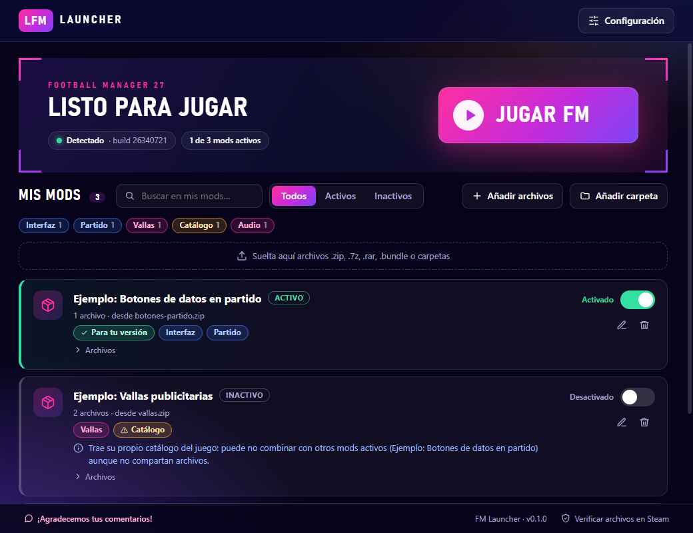

# FM Launcher

**Activa, desactiva y organiza los mods de Football Manager 27 sin tocar archivos a mano.**
Arrastra el `.zip` tal como lo descargaste, enciende el interruptor y juega.

[English version](README.en.md)



> Proyecto de aficionados, **no oficial**. No está afiliado ni respaldado por Sports Interactive ni por SEGA.
> Football Manager es marca de sus respectivos titulares.

---

## Descargar

[](https://github.com/pablotapiav/fm_launcher/releases/latest/download/FM-Launcher-Setup.exe)

Se instala con un clic y crea un acceso directo. Necesitas **Windows 10 u 11 (64 bits)** y **FM27 de Steam**.

¿Prefieres la versión **portable** (sin instalar) o ver las versiones anteriores? → **[Todas las versiones](../../releases)**

> **Windows puede mostrar un aviso azul** ("Windows protegió su PC"). Es normal en programas
> pequeños sin certificado de firma de pago. Pulsa **Más información → Ejecutar de todos modos**.
> El código es abierto: puedes revisarlo aquí mismo.

## Cómo se usa

1. **Abre el launcher.** Detecta FM27 solo. Si no lo encuentra, elige la carpeta en *Configuración*.
2. **Agrega un mod.** Arrastra el `.zip`, `.7z` o `.rar` a la ventana (o usa *Añadir archivos* / *Añadir carpeta*).
   También acepta carpetas y archivos `.bundle` sueltos.
3. **Enciende el interruptor** del mod. El launcher guarda una copia del archivo original y pone el del mod.
4. **Pulsa "Jugar FM"**. Abre el juego por Steam.
5. **Para volver atrás**, apaga el interruptor: se restaura el archivo original.

Con el juego abierto no se pueden activar ni desactivar mods; el launcher te avisa.

## Qué hace por ti

- **Reconoce el mod solo**, incluso dentro de un zip que copia la estructura del juego (`fm_Data/…`).
  Nunca ejecuta nada del zip: ignora scripts, instaladores y ejecutables.
- **Respaldos automáticos** de los archivos originales (los puedes mover o desactivar en *Configuración*).
- **Conflictos claros.** Dos mods que reemplazan el mismo archivo no pueden estar activos a la vez; el
  launcher lo avisa y ofrece **Cambiar a este mod** en un solo paso.
- **Etiquetas inteligentes** según lo que cambia cada mod (Vallas, Audio, Interfaz, Estadio…) y filtros.
- **Avisos de cuidado**: si un mod trae su propio catálogo del juego (suele romperse tras un parche) o fue
  hecho para otra versión del juego.
- **Detecta cambios**: si Steam actualiza o restaura un archivo, el mod aparece como inactivo.
- **Recuerda dónde está cada mod** y te avisa si lo moviste o lo borraste.
- Interfaz en **español** e **inglés**.

## Preguntas frecuentes

**¿Es seguro?** El launcher no envía datos ni se conecta a internet por su cuenta. Solo copia archivos
dentro de `fm_Data\StreamingAssets` de tu juego, con respaldo. Aun así, los mods son de terceros: bájalos
de fuentes que conozcas y prueba primero en una partida de prueba.

**Si el juego se actualiza, ¿pasa algo?** Steam puede reemplazar los archivos modificados; el launcher lo
detecta y marca el mod como inactivo. Si el mod no se actualizó para la nueva versión, puede no funcionar.
Como los respaldos son de la versión anterior, el launcher no los restaura sobre archivos nuevos: te
sugiere *Verificar archivos en Steam*.

**Ya instalé mods a mano. ¿Y ahora?** El launcher solo conoce los mods que le agregas. En el primer inicio
te ofrece seguir con tus archivos actuales o **verificar los archivos** (Steam los repone a su estado
original; esto también quita los mods manuales). Puedes hacerlo cuando quieras desde *Configuración* o desde
el enlace al pie de la ventana.

**¿Descarga mods por mí?** No. Los descargas tú del sitio que prefieras y los arrastras al launcher.

**¿Qué mods soporta?** Los que reemplazan archivos dentro de `fm_Data\StreamingAssets` (por ejemplo
bundles de interfaz, vallas, audio, catálogos). Los skins y gráficos que van en la carpeta *Documentos*
todavía no están soportados.

**¿Dónde guarda sus datos?** En `%APPDATA%\fm-launcher` (biblioteca, respaldos y los mods descomprimidos).
Desinstalar el launcher no borra esa carpeta.

**¿Y los `.7z` y `.rar`?** Se leen con las herramientas de Windows (`tar.exe`). Los `.zip` son los mejor
probados.

## Comentarios y errores

¡Agradecemos tus comentarios! Si tuviste un error, escríbenos:

- Twitter / X: **[@fm_chile](https://x.com/fm_chile)**
- GitHub: [abre un *Issue*](../../issues)

El launcher también tiene un botón **"¡Agradecemos tus comentarios!"** (abajo a la izquierda) y abre el mismo
cuadro solo si algo falla, con un botón para copiar los detalles del error.

---

## Para desarrolladores

Requiere Node.js 20 o superior y Windows.

```bash
npm install
npm run dev          # abre el launcher con recarga en caliente
npm test             # pruebas de la lógica (activar, conflictos, respaldos, zips, etiquetas…)
npm run typecheck
npm run dist         # genera el instalador y el portable en release/
```

- La lógica vive en `src/main/core` (sin dependencias de Electron, probada con carpetas temporales).
- La interfaz está en `src/renderer` (React). Los textos, en `src/renderer/src/i18n.ts`.
- Los enlaces de contacto están en `src/shared/links.ts`.
- `node scripts/make-icon.cjs` (con `npx electron`) regenera el ícono; `scripts/make-screenshot.cjs`, la captura.

### Publicar una versión

Las versiones se generan solas con GitHub Actions:

```bash
git tag v0.1.0
git push origin v0.1.0
```

El flujo `Release` compila en Windows, corre las pruebas y adjunta el instalador y el portable a una nueva
*Release*. El flujo `CI` corre las pruebas en cada cambio.

## Licencia

[MIT](LICENSE)
